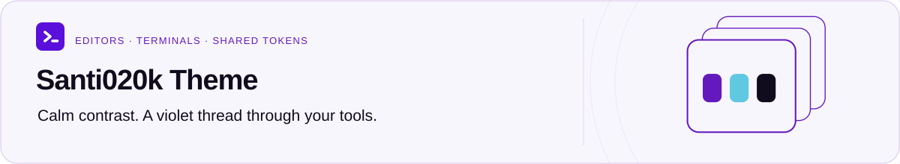

  <a href="../../README.md">
    <picture>
      <source media="(prefers-color-scheme: dark)" srcset="../../docs/assets/readme/workspace-dark.svg">
      
    </picture>
  </a>

<h1 align="center">Website</h1>

  
  

  <a href="../../README.md">Project overview</a> ·
  <a href="package.json">Package manifest</a> ·
  <a href="CHANGELOG.md">Changelog</a> ·
  <a href="#resources">Resources</a>

**On this page:** [Stack](#stack) · [Commands](#commands) · [Maintenance Notes](#maintenance-notes) · [Resources](#resources)

Static Astro site for [theme.santi020k.com](https://theme.santi020k.com), the entry point for the Santi020k Theme family.

The hub links visitors to the dedicated VS Code, Chrome, Terminal, and Zed theme sites, gives a compact cross-surface preview, and keeps future theme surfaces visible without turning the root site into a portfolio page.

## Stack

- Runtime: Astro with plain HTML, CSS, and JavaScript
- Shared tokens and helpers: `@santi020k/theme`
- Source: `src/pages/index.astro`, `src/main.js`, `src/styles.css`; home compositions in `src/styles/home.css`
- Public assets: `public/`
- Build output: `dist/`

## Commands

Run commands from the repository root.

| Command                 | What it does                                 |
| ----------------------- | -------------------------------------------- |
| `pnpm run site:dev`     | Starts the local hub dev server on port 4174 |
| `pnpm run site:build`   | Builds the production site                   |
| `pnpm run site:preview` | Previews the production build on port 4174   |
| `pnpm run validate`     | Runs the full monorepo validation suite      |

## Maintenance Notes

- `/gallery/` features eight current wallpaper designs: Halo, Contour, Glass, Satin, Ceramic, Tide, Dune, and Veil. Paired desktop/phone
  cards open a Lumen modal with appearance, device, resolution, and format controls. Each modal
  offers an explicit new-tab link; modified clicks and JavaScript-free links retain native page
  navigation. The modal and permanent page share `WallpaperWorkspace.astro`. Each design has
  one `/gallery/<design>/` page grouping dark/light and desktop/phone variants. Earlier artwork
  joins banners and logos at `/gallery/archive/`. VS Code screenshot cards are
  excluded from both galleries; product previews remain on the VS Code page. Existing file and
  ZIP URLs are unchanged.
- Wallpaper descriptions, paths, resolutions, and encoding profiles come from
  `../../artwork/wallpaper-catalog.mjs`. Update the image sitemap entries when adding a design.
- Development and build preparation generate static resolution/quality downloads from saved raster masters
  with `../../scripts/generate-wallpaper-downloads.mjs`. Run that script before using `astro dev`
  directly. Generated files under `public/downloads/wallpapers-v1/` are ignored by Git, cached by
  source/configuration fingerprint, and included in the deployed build. The primary download
  chooser enhances a complete server-rendered list of native links, which also works without JS.
- Desktop exports are 1920 × 1080, 2560 × 1440, and 3840 × 2160. Phone exports are 1080 × 2340
  and 1170 × 2532. WEBP has quality 80 and 94 profiles; JPG uses 92; PNG is lossless. Resizing
  generated masters does not create native 4K detail. No SVG export is offered for raster artwork.
- `pnpm run validate:links` checks rendered static pages as well as source references; run a
  site build first so dynamic wallpaper routes and their download files can be verified.

- Keep product links aligned with their canonical routes under `https://theme.santi020k.com/`.
- Load hub styles from Astro layouts/pages so client navigation preserves styles and direct loads
  render correctly without depending on the client script to insert CSS.
- Preserve visible focus styles, external-link safety, and the dark/light toggle.
- The `/design/` palette reveals HEX, RGB, and HSL values through each swatch's keyboard-accessible Color codes disclosure. Values read active shared CSS tokens and stay synchronized with appearance changes and page navigation instead of maintaining a second palette.
- Keep preview assets in `public/` aligned with current package screenshots.
- The home hero uses paired light/dark violet glass and ceramic artwork from `artwork/hub-hero-v3/`,
  with optimized responsive WEBP output following site appearance. Header, mobile menu, and footer share `Brand.astro` and the
  canonical favicon mark.
- The Sculpted home page pairs an open hero with a workspace detail strip, a featured VS Code preview, numbered tool rows, one package code surface, and image-led wallpaper downloads. Featured wallpapers pair Ceramic light, Satin dark, and Dune light in their full desktop proportions, with edition-specific downloads. Home styles stay scoped to `.home-page`; shared navigation and product pages keep their own composition.
- The home theme cards use `src/components/ThemeCardPreview.astro`: canonical VS Code screenshots, generated Chrome store artwork, and labeled illustrative previews for other tools. Preview colors derive from the paired VS Code theme sources and follow site appearance. Keep illustrative scenes free of private data and do not present them as native captures.
- Read [`../../docs/brand-guidelines.md`](../../docs/brand-guidelines.md) before changing copy, color, imagery, or product naming.

For deeper implementation notes, see [`WEBSITE.md`](WEBSITE.md).

## Resources

[Project overview](../../README.md) · [Contributing](../../CONTRIBUTING.md) · [License](../../LICENSE)
